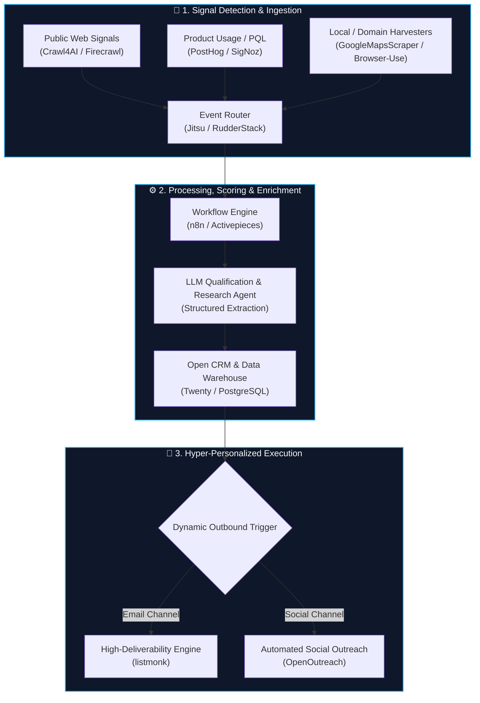

  

# 🚀 Awesome Intent-Driven Outbound Sales Systems

**A curated index of cutting-edge SaaS platforms, data providers, and open-source GitHub projects powering signal-led B2B revenue engines.**

  
  
  
  
  
  
  

*Curated for GTM Engineers, RevOps Leads, Growth Hackers, and AI SDR Architects.*

---

## 📌 Executive Summary & Introduction

Modern B2B outbound has undergone a fundamental paradigm shift: **cold mass emailing is dead**. In response to aggressive email provider spam filters, deliverability constraints, and buyer fatigue, high-performing revenue organizations are standardizing on **Intent-Driven Outbound Sales**.

Instead of static, generic lead lists, modern outbound stacks listen for **real-time public and first-party signals**—executive moves, hiring ramp-ups, tech-stack migrations, funding announcements, website visitor de-anonymization, and community discussions—triggering hyper-personalized outreach at the exact window of buying readiness.

This repository tracks the leading **commercial SaaS solutions** and **open-source developer tooling** powering this transition.

---

## 🌐 Sector Overview & Market Dynamics

> 📊 **Estimated Market Size**: The global B2B Intent Data & Sales Intelligence market is valued at approximately **$4.8B – $6.5B in 2025–2026**, projected to reach **$12.4B+ by 2030** at an estimated CAGR of **~14.2%**, fueled by enterprise adoption of autonomous AI SDRs, automated waterfall enrichment pipelines, and the phaseout of legacy third-party cookies.
>
> 🧩 **Market Fragmentation & Dynamics**: The sector exhibits **moderate fragmentation with a bifurcated barbell structure**. Foundational contact graphs and publisher-network intent data remain relatively concentrated among legacy incumbents (such as ZoomInfo and Bombora). Conversely, the orchestration, enrichment, and outreach execution layer is **highly fragmented and anti-monopolistic**—pliable waterfall workflow builders (such as Clay), AI research agents, and specialized open-source scrapers are unbundling legacy monolithic suites, preventing a single "winner-take-all" lock-in.

---

## 📑 Table of Contents

- [🚀 Awesome Intent-Driven Outbound Sales Systems](#-awesome-intent-driven-outbound-sales-systems)
  - [📌 Executive Summary & Introduction](#-executive-summary--introduction)
  - [🌐 Sector Overview & Market Dynamics](#-sector-overview--market-dynamics)
  - [📑 Table of Contents](#-table-of-contents)
  - [🏢 Enterprise SaaS & Hosted Platforms](#-enterprise-saas--hosted-platforms)
  - [💻 Open-Source GitHub Projects](#-open-source-github-projects)
  - [🏗️ Recommended Architecture: Self-Hosted Composable Stack](#️-recommended-architecture-self-hosted-composable-stack)
  - [🤝 How to Contribute](#-how-to-contribute)
  - [💖 Support & Sponsoring](#-support--sponsoring)
  - [⭐ Star History](#-star-history)
  - [⚖️ Disclaimer & Compliance](#️-disclaimer--compliance)

---

## 🏢 Enterprise SaaS & Hosted Platforms

The table below lists the category-defining SaaS and hosted platforms for intent-driven sales intelligence, sorted in descending order by **Company Scale (Valuation / Revenue)**.

| 🏢 Platform | 📈 Scale (Valuation / ARR) | 💵 Pricing (Specific Starting Tier) | 🎁 Free Tier & Trial Limits | 🎯 Core Focus & Intent Signals |
| :--- | :--- | :--- | :--- | :--- |
| **[6sense](https://6sense.com/)** | **$5.2B Valuation** (Series E) • ~$240M ARR | **$25,000 / year** (approx. $2,083/month base contract for ABM platform) | **No free forever plan**; offers a **30-day interactive sandbox trial** upon sales qualification (preview intent clusters & buying stages) | Account-based orchestration with proprietary B2B intent network (4,000+ publisher nodes), predictive buying stage AI, and Revvy conversational orchestration. |
| **[ZoomInfo](https://www.zoominfo.com/)** | **$4.1B Market Cap** (NASDAQ: ZI) • **$1.24B ARR** | **$14,995 / year** (approx. $1,250/month for Professional+ tier with annual commitment) | **No free forever plan**; provides a **14-day free trial** with 25 verified contact export credits and basic firmographic search | Comprehensive B2B intelligence database, streaming intent signals, org charts, technographics, and Copilot AI for sales workflow automation. |
| **[Demandbase](https://www.demandbase.com/)** | **$3.2B Valuation** • ~$165M ARR | **$24,000 / year** (approx. $2,000/month for ABM Essentials tier) | **No free forever plan**; provides a **14-day guided proof-of-concept sandbox** with up to 50 sample target accounts and intent surge reports | Account-based GTM platform combining third-party intent data, account identification, buying group discovery, and cross-channel ad/email orchestration. |
| **[Apollo.io](https://www.apollo.io/)** | **$1.6B Valuation** (Series D) • ~$120M ARR | **$49 / user / month** (billed annually at $588/yr, or $59/mo monthly for Basic tier) | **Free forever plan available**: includes 10,000 email credits/account/month (with export limits), 60 mobile numbers/year, and basic sequence automation | Sales intelligence repository with 275M+ verified contacts, built-in cold email sequences, dialer, buyer intent filters, and AI email generation. |
| **[Clay](https://clay.com/)** | **$1.3B Valuation** (Series B) • ~$45M ARR | **$134 / month** (Starter plan billed annually at $1,608/yr, or $149/mo monthly) for 2,000 credits/mo | **Free forever plan available**: includes 100 enrichment credits/month, 1 user seat, access to 75+ waterfall enrichment data providers, and 1,000 table rows | Programmable GTM spreadsheet interface for waterfall enrichment (100+ providers), AI research agents, company scraping, and dynamic email personalization. |
| **[Bombora](https://bombora.com/)** | **~$500M Valuation** • ~$65M ARR | **$20,000 / year** (approx. $1,667/month for direct Company Surge data access) | **No free forever plan**; provides a **1-time free Surge Report** monitoring up to 25 domains across 10 intent topics, or **14-day trial** via certified partner integrations | The foundational B2B intent data co-op aggregating behavioral content consumption across 5,000+ premium business publisher websites. |
| **[Common Room](https://www.commonroom.io/)** | **~$350M Valuation** (Series B) • ~$18M ARR | **$1,000 / month** (Team tier) supporting up to 25,000 community members and 500 signals/month | **Free forever plan available**: includes up to 1,000 tracked community/developer members, 1 data integration (e.g., Slack or GitHub), and 1 user seat | Community and product signal intelligence platform capturing intent from GitHub, Slack, Discord, LinkedIn, and product usage to score warm leads. |
| **[Warmly](https://warmly.ai/)** | **~$80M Valuation** (Series A) • ~$8M ARR | **$500 / month** (Starter plan) for up to 1,000 de-anonymized website accounts/month | **Free forever plan available**: de-anonymizes up to 100 monthly web visitors, 25 LinkedIn lead reveals, and real-time Slack/Teams visitor alerts | Real-time website visitor de-anonymization, autonomous chat, video greetings, and automated outbound triggers based on live browsing intent. |
| **[Regie.ai](https://www.regie.ai/)** | **~$60M Valuation** (Series A) • ~$7M ARR | **$59 / user / month** (Pro tier billed annually) or $89/user/month for Co-Pilot | **No free forever plan**; offers a **14-day free trial** with 100 AI email generation credits and 25 prospect research lookups | Generative AI sales engagement and Autonomous SDR platform that drafts personalized emails, manages sequences, and triggers contextual follow-ups. |
| **[Factors.ai](https://factors.ai/)** | **~$40M Valuation** (Series A) • ~$4M ARR | **$99 / month** (Starter plan) for up to 1,000 account de-anonymizations/month | **Free forever plan available**: identifies up to 100 companies/month, tracks 10,000 events, unlimited user seats, plus a **14-day free trial** of Growth tier | B2B marketing analytics and intent platform offering IP-to-company resolution, multi-touch attribution, and account journey visualization. |

---

## 💻 Open-Source GitHub Projects

Curated open-source projects for building custom, vendor-independent, self-hosted intent-driven outbound engines. **Sorted in descending order by GitHub Stars.**

| 💻 Project & Repository | ⭐ Stars | 📜 License | 🛠️ Architecture Category | 💡 Intent & Outbound Capabilities |
| :--- | :--- | :--- | :--- | :--- |
| **[n8n](https://github.com/n8n-io/n8n)** |  | Fair-code (Sustainable Use) | Workflow & Intent Orchestration | Fair-code workflow automation with 400+ nodes. The defacto engine for wiring webhook-based intent triggers (funding, hiring, RSS, GitHub stars) into automated multi-step outreach pipelines. |
| **[Firecrawl](https://github.com/mendableai/firecrawl)** |  | AGPL-3.0 | Web Scraping & AI Extraction | Crawls entire websites and converts them into LLM-ready markdown or clean structured schemas. Essential for extracting public company intelligence, leadership changes, product updates, and pricing changes. |
| **[Browser Use](https://github.com/browser-use/browser-use)** |  | MIT | AI Agent Browser Automation | Enables autonomous AI agents to interact with web browsers to research companies, scrape dynamic prospect portals, verify contacts, and conduct multi-step deep research across gated websites. |
| **[Crawl4AI](https://github.com/unclecode/crawl4ai)** |  | Apache-2.0 | High-Speed LLM Crawler | Lightweight, open-source asynchronous web crawler engineered specifically for LLMs. Perfect for high-speed batch enrichment of corporate domains, tech-stack fingerprinting, and signal gathering. |
| **[Twenty](https://github.com/twentyhq/twenty)** |  | AGPL-3.0 | Open-Source CRM & Data Layer | Modern, customizable open-source CRM alternative to Salesforce and HubSpot. Serves as the central persistent system of record for account scoring, custom signal fields, and outbound lifecycle tracking. |
| **[PostHog](https://github.com/PostHog/posthog)** |  | MIT / Hobby | Product Analytics & PQL Signals | Open-source product telemetry, event tracking, and session replay suite. Enables GTM engineering teams to capture real-time Product-Qualified Lead (PQL) signals when accounts hit key activation thresholds. |
| **[SigNoz](https://github.com/SigNoz/signoz)** |  | Apache-2.0 | OpenTelemetry Observability | Open-source APM and observability platform. Correlates technical telemetry (API call surges, enterprise SDK installations, rate-limit warnings) with enterprise expansion and purchasing intent. |
| **[Activepieces](https://github.com/activepieces/activepieces)** |  | MIT | AI-First Workflow Automation | Open-source alternative to Zapier featuring 280+ apps and native AI copilot nodes. Exposes connectors as MCP (Model Context Protocol) tools for autonomous sales agents to execute targeted outreach actions. |
| **[listmonk](https://github.com/knadh/listmonk)** |  | AGPL-3.0 | High-Throughput Email Delivery | High-performance, self-hosted newsletter and transactional email delivery manager built with Go and PostgreSQL. Ideal for controlling cold outbound email deliverability, custom headers, and rate limits. |
| **[Dagster](https://github.com/dagster-io/dagster)** |  | Apache-2.0 | Data Orchestration & Lineage | Cloud-native data orchestrator for ML and analytics. Built for defining software-defined intent assets, managing complex ETL/ELT pipelines from public registries, and scheduling daily data refreshes. |
| **[Jitsu](https://github.com/jitsucom/jitsu)** |  | MIT | Real-Time CDP & Event Pipeline | Open-source data ingestion engine and Customer Data Platform (CDP). Ingests real-time events from web, mobile, and third-party webhooks, routing intent signals directly to warehouse or CRM storage. |
| **[RudderStack](https://github.com/rudderlabs/rudder-server)** |  | AGPL-3.0 | Customer Data Infrastructure | Warehouse-native customer data pipeline. Collects and routes event data across 200+ destinations, powering unified buyer profiles across marketing, sales, and analytics tools. |
| **[OpenOutreach](https://github.com/eracle/OpenOutreach)** |  | Apache-2.0 | LinkedIn Automation & Qualification | Production-ready LinkedIn outreach automation engine. Features fuzzy natural language prospect qualification, automated profile evaluation via LLMs, persistent Playwright browser sessions, and email extraction. |
| **[GoogleMapsScraper](https://github.com/gaspa93/googlemaps-scraper)** |  | MIT | Local Intent & B2B Lead Scraping | Specialized scraper for harvesting local business leads, addresses, phones, websites, and review counts from Google Maps. Employs AI web crawlers to discover verified business email addresses from company sites. |

---

## 🏗️ Recommended Architecture: Self-Hosted Composable Stack

For engineering teams seeking to avoid vendor lock-in and high seat licenses of legacy ABM platforms, here is the reference architecture for a self-hosted intent-driven outbound system:

---

## 🤝 How to Contribute

We welcome additions, corrections, and updates from the community!

1. 🍴 **Fork the repository** to your GitHub account.
2. 🌿 **Create a new branch** (`git checkout -b feature/add-new-tool`).
3. 📝 **Add or edit entries in `README.md`**:
   - For **SaaS tools**, ensure you provide exact starting tier pricing, specific free tier/trial limits, and company scale metrics.
   - For **Open-Source projects**, include GitHub star badges linking to the repository's stargazers page and ensure entries remain sorted by star count.
4. 🚀 **Commit your changes** (`git commit -m 'feat: add tool X with pricing & intent capabilities'`).
5. 📤 **Push to your branch** (`git push origin feature/add-new-tool`).
6. 🎯 **Open a Pull Request** with a concise description of the tool's relevance to intent-driven sales.

---

## 💖 Support & Sponsoring

Thank you for visiting and using this ecosystem guide! If you find this repository valuable for your outbound architecture, research, or GTM workflows:

- ⭐ **Star this repository** to help others discover it.
- 🍴 **Fork and contribute** new intent signals, tools, or open-source projects.
- 📢 **Share it** with your RevOps, GTM engineering, or sales colleagues on Twitter/X and LinkedIn.
- ☕ **Buy me a coffee / Sponsor**: Support ongoing maintenance and research via the [GitHub Sponsors Dashboard](https://github.com/sponsors/ishandutta2007).

---

##  Star History

---

## ⚖️ Disclaimer & Compliance

- 🛡️ **Regulatory Compliance**: Processing prospective buyer data must adhere to global and local privacy mandates, including the **General Data Protection Regulation (GDPR)**, **California Consumer Privacy Act (CCPA)**, and **CAN-SPAM Act**.
- ⚠️ **Platform Terms of Service**: Automating social channels (such as LinkedIn) may conflict with third-party platform Terms of Service. Always employ sensible throttling, account warm-up schedules, and human-in-the-loop review.
- 💡 **Data Verification**: While open-source scrapers and public company intelligence provide high transparency and low marginal costs, teams should continuously monitor email bounce rates and domain reputation to protect deliverability.

---

  <b>Built for modern GTM Engineers, RevOps teams, and Outbound Builders.</b> 
  <i>Let's make B2B outbound smarter, signal-driven, and truly valuable to buyers.</i>

